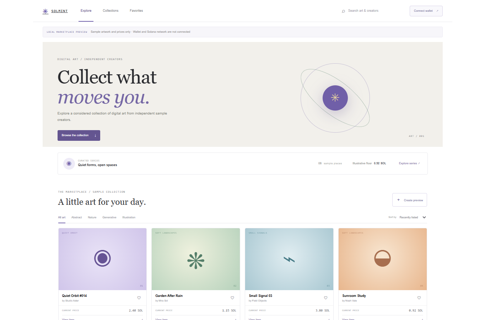

# SolMint

A marketplace interface showcase with sample artwork listings, collections, filters, favorites, and a local mint preview form. The listed creators and artworks are fictional sample data.

## Run locally

From the workspace root, run `npm install`, then `npm run dev --workspace=solmint-nft` and open `http://localhost:3010`. For production, run `npm run build --workspace=solmint-nft` and `npm run start --workspace=solmint-nft`.

## Features

- Browse and filter sample listings by art category; sort by illustrative price.
- View item details and save local favorites.
- Create an unminted local preview with a name and optional local file-name selection.
- Anchor source in `programs/solmint` includes a zero-decimal SPL mint with a program-owned metadata record, escrow-backed listing, purchase, and seller cancellation.
- Responsive marketplace layout with repeated disclosure that wallet/chain actions are unavailable.

## Scope and wallet boundary

The browser demo has no wallet adapter or RPC connection; its mint preview remains local and does not invoke the Anchor source. The Anchor program mints a standard SPL token and records name, symbol, and URI in a program PDA; it does not implement Metaplex metadata. Listing escrows one token in a listing PDA's associated token account, buying transfers the listed lamports and NFT atomically, and the seller can cancel. No program is deployed. The configured program ID is a development identifier without a generated deployment keypair.

## Anchor source

The Anchor workspace is pinned to 1.2.2 and targets localnet by default. With Rust, Solana/Agave tools, and Anchor 1.2.2 installed, run `cargo fmt --all`, `cargo test --workspace`, `cargo check --workspace`, and `anchor build --ignore-keys` from this directory. Anchor may create an ignored local build keypair under `target/`; it is not synced with the source ID and is not a deployment key. Before any Devnet deployment, generate an intentional program keypair, sync the program ID, and update the Anchor configuration to `Devnet`. This source has not been security-audited; do not use it with valuable assets. No deploy keypair, deployment, or Devnet transaction is included in this demo.

`cargo test --workspace` runs local `solana-program-test` transactions for an empty-vault rejection, a successful paid purchase, and seller cancellation. The purchase and cancellation flows use the SPL Token processor and verify NFT balances, payment, and closure of consumed listing and vault accounts. The tests use no external cluster.

## Tech stack badges

   

## Screenshots

## Environment variables

No environment variables are required. This showcase uses local sample data and runs without paid APIs or external credentials.
